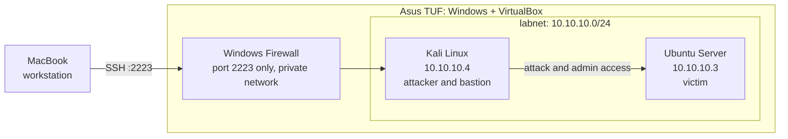

# Purple Team Lab

What the lab is:
A home lab where I practice both sides of security: I attack my own
machines, then investigate the traces the attack left and fix what
allowed it.

I'm a full-stack developer moving into security, starting from zero.
Every exercise here follows the same cycle: attack, detect, respond,
harden, and document. The lab runs on VirtualBox, with a Kali attacker
and an Ubuntu victim on an isolated network.

## Diagram

## Exercises

| # | Exercise | Status |
|---|----------|--------|
| 01 | [SSH brute force](exercises/01-ssh-brute-force/README.md) | done |
| 02 | [TODO](exercises/02-new-exercise/README.md) | in progress |

## Lab documentation

- [Architecture](lab/architecture.md): the VMs, the labnet, the bastion and the reasoning behind each choice
- [Setup](lab/setup.md): step-by-step guide to build the same lab

## Notes

- [Week 01](notes/week-01.md)
