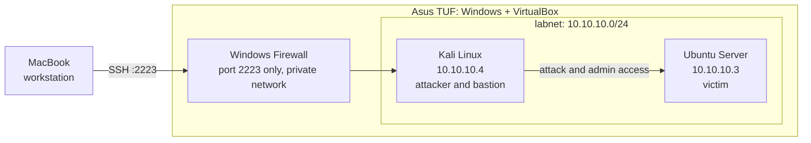
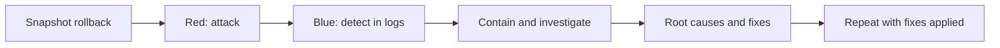

# Purple Team Lab

A home lab where I play both sides of a security exercise: I run a real attack from Kali (red), then detect it in the logs, contain it and investigate it on the victim (blue). Each exercise is mapped to a MITRE ATT&CK technique and documented like an incident report: scenario, attack, detection, timeline, response, root causes and what I learned.

Everything runs on isolated VMs that I own, on a network the rest of my home network can't reach.

## Diagram

## How each exercise works

## Exercises

| # | Exercise | Status |
|---|----------|--------|
| 01 | [SSH brute force](exercises/01-ssh-brute-force/README.md) | done |

## Lab documentation

- [Architecture](lab/architecture.md): the VMs, the labnet, the bastion and the reasoning behind each choice
- [Setup](lab/setup.md): step-by-step guide to build the same lab

## Notes

- [Week 01](notes/week-01.md)
