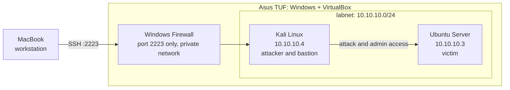

# Lab architecture

A purple team lab built on a laptop, with an attacker machine and a victim on an isolated network. I work from another machine over my home network, without any attack traffic leaving the lab.

## Overview



## Machines

| Machine | Role | OS | Resources | IP |
|---|---|---|---|---|
| Asus TUF | VM host | Windows 11 + VirtualBox 7 | i7-12700H, 16 GB RAM, 1 TB SSD | Home network (DHCP) |
| MacBook Air M4 | Workstation | macOS | | Home network |
| `ubuntu` | Victim | Ubuntu Server 26.04 LTS | 2 CPUs, 2 GB RAM, 25 GB | `10.10.10.3` |
| `kali` | Attacker and bastion | Kali Linux 2026.3 | 2 CPUs, 3 GB RAM, 80 GB dynamic | `10.10.10.4` |


## Network

| Item | Value |
|---|---|
| VirtualBox mode | NAT Network |
| Name | `labnet` |
| Range | `10.10.10.0/24` |
| Gateway | `10.10.10.1` |
| DHCP | On |

### Port forwarding

| Rule | Host | Guest | Reachable from |
|---|---|---|---|
| `ssh-ubuntu` | `127.0.0.1:2222` | `10.10.10.3:22` | The Asus itself only |
| `ssh-kali` | Asus IP on the home network, port `2223` | `10.10.10.4:22` | Devices on the home network |

### Windows Firewall

A single inbound rule: TCP `2223`, allowed only on the **Private** profile. On a public network (café, airport), the port stays closed.

## Access

```bash
# Mac to Kali
ssh -p 2223 kali@<asus-ip>

# Mac to Ubuntu, jumping through Kali
ssh -J kali@<asus-ip>:2223 <user>@10.10.10.3

# copy files from Ubuntu to the Mac
scp -J kali@<asus-ip>:2223 <user>@10.10.10.3:~/file .
```

## Decisions

| Decision | Rejected alternative | Reason |
|---|---|---|
| NAT Network | Bridged adapter | The VMs see each other and have internet, but the home network can't reach the lab. A scan with the wrong IP won't hit real devices |
| Kali on the Asus | Kali on the Mac | With Kali outside `labnet`, the attack would cross the home network and reach Ubuntu through the `10.10.10.1` gateway, erasing the attacker's IP from the log |
| Kali as bastion | Exposing Ubuntu's SSH on the home network | The victim has weak accounts on purpose. It is only reachable from inside the lab |
| Ubuntu bound to `127.0.0.1` | Listening on all interfaces | Reduces exposure: only the Asus itself uses port 2222 |
| Ubuntu Server without a GUI | Ubuntu Desktop | Less memory and less attack surface. Everything is done over SSH |
| VirtualBox on Windows | Dual boot or Proxmox | Windows is still in use on the Asus. Snapshots and isolated networks are enough for the lab |

## Snapshots

| VM | Snapshot | State |
|---|---|---|
| `ubuntu` | `limpa` (clean) | Installed, updated, disk expanded, old NAT network |
| `ubuntu` | `labnet` | Migrated to `labnet` |
| `kali` | `limpa` (clean) | Imported, default password changed, SSH enabled |

Before each exercise, the VMs are rolled back to the appropriate snapshot.

## Known limitations

- **NAT hides the source.** Everything coming in through port forwarding shows up on Ubuntu as `10.10.10.1`. Admin access through the bastion shows up as `10.10.10.4`, the same IP as the attacker.
- **DHCP IPs.** The VM and Asus IPs can change and break the forwarding rules. Future fix: static IPs and a DHCP reservation on the router.
- **Memory.** With 16 GB on the host and Windows using part of it, 3 to 4 VMs fit at the same time.
- **Starting and stopping VMs** still requires physical access to the Asus.
