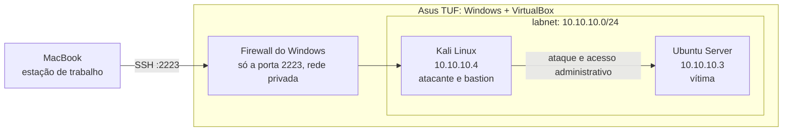

# Arquitetura do lab

Lab de purple team montado num notebook, com uma máquina atacante e uma vítima numa rede isolada. Eu trabalho a partir de outra máquina, pela rede de casa, sem que o tráfego de ataque saia do lab.

## Visão geral



## Máquinas

| Máquina | Papel | Sistema | Recursos | IP |
|---|---|---|---|---|
| Asus TUF | Hospedeiro das VMs | Windows 11 + VirtualBox 7 | i7-12700H, 16 GB RAM, SSD 1 TB | Rede de casa (DHCP) |
| MacBook Air M4 | Estação de trabalho | macOS | | Rede de casa |
| `ubuntu` | Vítima | Ubuntu Server 26.04 LTS | 2 CPUs, 2 GB RAM, 25 GB | `10.10.10.3` |
| `kali` | Atacante e bastion | Kali Linux 2026.3 | 2 CPUs, 3 GB RAM, 80 GB dinâmico | `10.10.10.4` |


## Rede

| Item | Valor |
|---|---|
| Modo do VirtualBox | Rede NAT |
| Nome | `labnet` |
| Faixa | `10.10.10.0/24` |
| Gateway | `10.10.10.1` |
| DHCP | Ligado |

### Redirecionamento de portas

| Regra | Hospedeiro | Convidado | Quem alcança |
|---|---|---|---|
| `ssh-ubuntu` | `127.0.0.1:2222` | `10.10.10.3:22` | Só o próprio Asus |
| `ssh-kali` | IP do Asus na rede de casa, porta `2223` | `10.10.10.4:22` | Aparelhos da rede de casa |

### Firewall do Windows

Uma única regra de entrada: TCP `2223`, permitida apenas no perfil **Privado**. Em rede pública (café, aeroporto), a porta fica fechada.

## Acesso

```bash
# Mac para o Kali
ssh -p 2223 kali@<ip-do-asus>

# Mac para o Ubuntu, atravessando o Kali
ssh -J kali@<ip-do-asus>:2223 <usuario>@10.10.10.3

# copiar arquivos do Ubuntu para o Mac
scp -J kali@<ip-do-asus>:2223 <usuario>@10.10.10.3:~/arquivo .
```

## Decisões

| Decisão | Alternativa descartada | Motivo |
|---|---|---|
| Rede NAT | Placa em modo bridge | As VMs se enxergam e têm internet, mas a rede de casa não alcança o lab. Um scan com IP errado não atinge aparelhos reais |
| Kali no Asus | Kali no Mac | Com o Kali fora da `labnet`, o ataque passaria pela rede de casa e chegaria ao Ubuntu pelo gateway `10.10.10.1`, apagando o IP do atacante no log |
| Kali como bastion | Expor o SSH do Ubuntu na rede de casa | A vítima tem contas fracas de propósito. Ela só é alcançável de dentro do lab |
| Ubuntu preso a `127.0.0.1` | Escutar em todas as interfaces | Reduz a exposição: só o próprio Asus usa a porta 2222 |
| Ubuntu Server sem interface gráfica | Ubuntu Desktop | Menos memória e menos superfície de ataque. Tudo é feito por SSH |
| VirtualBox sobre o Windows | Dual boot ou Proxmox | O Windows continua em uso no Asus. Snapshots e redes isoladas atendem o lab |

## Snapshots

| VM | Snapshot | Estado |
|---|---|---|
| `ubuntu` | `limpa` | Instalado, atualizado, disco expandido, rede NAT antiga |
| `ubuntu` | `labnet` | Migrado para a `labnet` |
| `kali` | `limpa` | Importado, senha padrão trocada, SSH ligado |

Antes de cada exercício, as VMs voltam para o snapshot adequado.

## Limitações conhecidas

- **NAT esconde a origem.** Tudo que entra pelo redirecionamento aparece no Ubuntu como `10.10.10.1`. O acesso administrativo pelo bastion aparece como `10.10.10.4`, o mesmo IP do atacante.
- **IPs via DHCP.** Os IPs das VMs e do Asus podem mudar e quebrar as regras de redirecionamento. Correção futura: IPs fixos e reserva no roteador.
- **Memória.** Com 16 GB no hospedeiro e o Windows usando parte, cabem 3 a 4 VMs ao mesmo tempo.
- **Ligar e desligar VMs** ainda exige acesso físico ao Asus.
